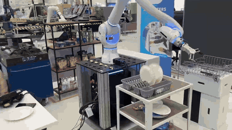
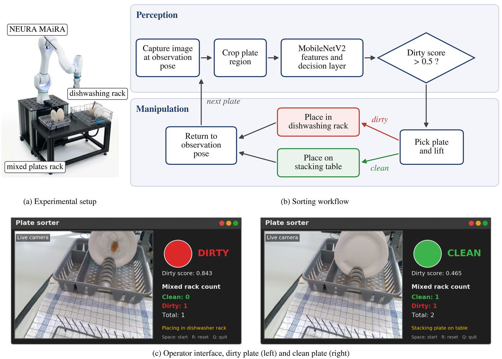
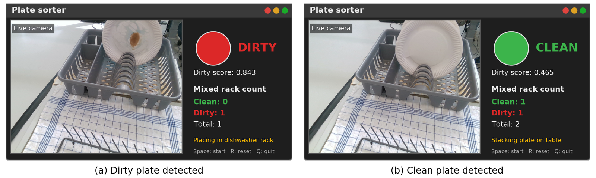
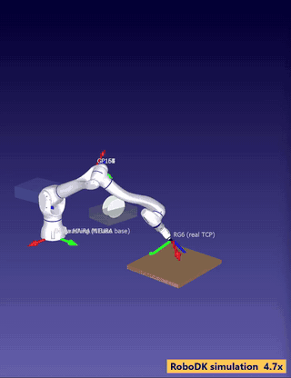
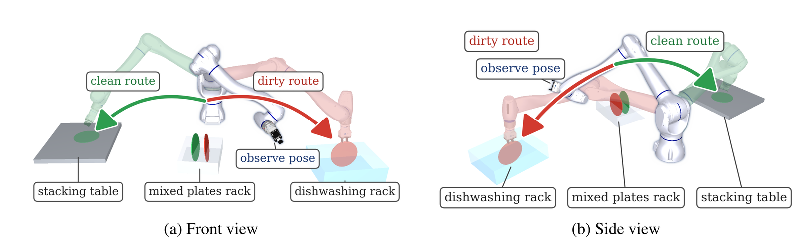
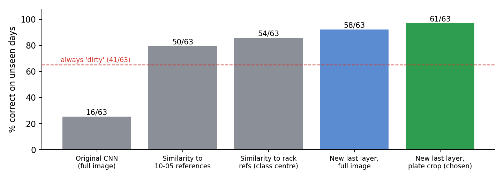

<h1 align="center">DishMATE</h1>

<p align="center">
  A collaborative robot that checks each plate with a camera and sorts it:<br>
  dirty plates go into the dishwasher rack, clean plates go onto the stacking table.
</p>

<p align="center">
  
</p>

<p align="center">
  
  
  
  
  
</p>

---

## Overview

DishMATE runs on a NEURA MAiRA arm with an RG6 gripper. Plates wait in a mixed
rack. For each one, the robot moves to an observation pose, takes a photo, and a
small classifier decides whether the plate is clean or dirty. The robot then picks
the plate up and places it in the right spot. Every step is mirrored live in a
RoboDK digital twin, and an operator window shows the camera feed, the decision
and a running count.

<p align="center">
  
</p>

## How it works

**Perception.** The camera image is cropped to the plate area. A MobileNetV2
backbone pretrained on ImageNet turns the crop into features, and a small final
layer trained on labelled rack photos gives a dirty score. Plates scoring above
0.5 are treated as dirty.

**Manipulation.** Pick, observe and drop poses are taught on the pendant and
stored in `settings.json`. Each cycle is: observe and classify, pick and lift,
place at the clean or dirty point, then return to observe for the next plate.

**Operator interface.** A desktop sorting window and a browser-based workcell UI
both show the live camera, the classification result and the robot's current step.

<p align="center">
  
</p>

## Digital twin

The RoboDK station follows the real robot's joints from `/joint_states`. Plates
attach and detach in sync with the real gripper, so the twin shows where each
plate went. The station is built from the same taught points the robot uses.

<table>
  <tr>
    <td width="34%" align="center"></td>
    <td width="66%" align="center"></td>
  </tr>
  <tr>
    <td align="center"><sub>Simulated sorting run</sub></td>
    <td align="center"><sub>Clean and dirty routes, front and side views</sub></td>
  </tr>
</table>

More detail: [Sim-to-real guide](docs/SIM2REAL_GUIDE.md).

## Results

We tested the rack classifier on 63 photos from capture days it had not seen
during training (41 dirty, 22 clean). It classified 61 of them correctly and caught
all 41 dirty plates. The original full-image CNN got 16 of the same 63 right.

<p align="center">
  
</p>

| Classifier | Correct | Dirty plates caught |
|---|---|---|
| Original CNN, full image | 16 / 63 | 5 / 41 |
| MobileNetV2 + new final layer, plate crop | **61 / 63** | **41 / 41** |

These figures come from a small set of plates in one fixed setup. The crop
assumes the rack and camera stay where they are now. See the
[rack classifier report](docs/RACK_CLASSIFIER_REPORT_2026-10-20.pdf) for the full evaluation.

## Getting started

The robot side runs under WSL (Ubuntu 20.04, ROS Noetic, Python 3.8). The
classifier runs in a separate Python 3.10 environment with TensorFlow.

```bash
# in Ubuntu 20.04
cd /mnt/c/Users/aimat/Desktop/Dishwashing_Maira
source ./activate_wsl.sh
bash tests/check_classifier.sh        # model loads and runs, no robot access

python sort_gui.py                    # camera and classification only, no motion
python sort_gui.py --robot            # Space starts sorting cycles
```

On Windows, `run_dishwashing.bat` starts the backend, the web UI and the RoboDK
twin together. The robot only moves after you press Start in the UI.

Before running with `--robot`, put the robot in Automatic mode, set `clean_place`
and `dirty_place` in `settings.json`, and keep the emergency stop within reach.

The full instructions are in the **[usage guide](docs/USAGE.md)**. It covers
environment setup, data capture and annotation, training, evaluation and
pick-and-place options.

## Repository layout

```
rack_classifier.py      plate-crop classifier (default)
sort_gui.py             desktop sorting window, optional robot control
pick_cycles.py          pick-and-place cycles
run_dishwashing.py      launcher for UI, robot bridge and RoboDK twin
camera_viewer.py        live camera, capture and annotation
annotate_dishes.py      multi-dish bounding-box annotation
train_classifier.py     CNN training pipeline
robodk_sim/             RoboDK station builder and twin
ui/                     workcell web UI (backend and frontend)
setup/                  one-time environment setup scripts
tests/                  automated tests and diagnostics
docs/                   guides, reports and figures
```

Run the tests with `python -m unittest discover -s tests -v`.

## Documentation

- [Usage guide](docs/USAGE.md)
- [Camera setup](docs/CAMERA_SETUP.md)
- [Sim-to-real guide](docs/SIM2REAL_GUIDE.md)
- [CNN training results](docs/CNN_TRAINING_2026-10-05.md)
- [Workcell UI](ui/README.md)
